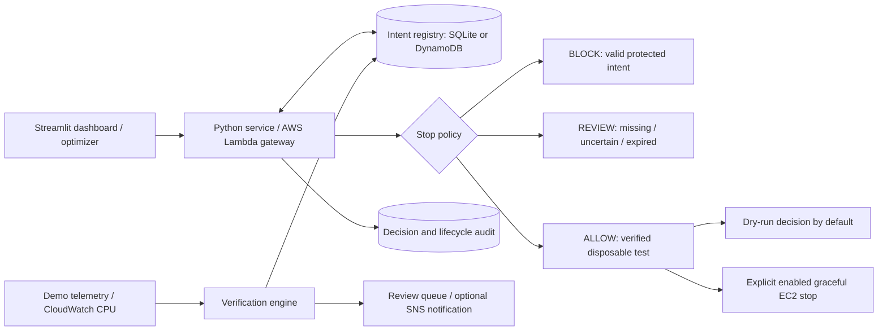

# IntentGuard

A Python MVP for **verifiable, expiring resource intent before AWS cost optimization**.
BCSE355L Cloud Architecture Design course project.

An idle backup and an unused test server can look similar in CPU metrics. IntentGuard records why each resource exists, checks its declared telemetry signature, and gates stop requests with **ALLOW**, **BLOCK**, or **REVIEW**.

## Run your first demonstration

Requires Python 3.11 or newer. From this repository folder:

```sh
python3 -m venv .venv
source .venv/bin/activate
python -m pip install -e '.[dev]'
python -m intentguard demo
python -m streamlit run app.py --server.address 127.0.0.1
```

On Windows, activate with `.venv\Scripts\activate` instead.
The command-line demo uses the Python standard library and can also run before installing dependencies.
Open the local dashboard URL printed by Streamlit. **Local demo needs no AWS account or credentials.**

Expected initial decisions:

| Simulated resource | Decision | Why |
|---|---|---|
| Standby backup | BLOCK | Active protected-purpose declaration |
| Disposable test | ALLOW, dry run | Matching CPU signature and explicit disposable tags |
| Expired backup | REVIEW | Owner must renew and reverify |
| Undeclared server | REVIEW | Idle CPU is insufficient permission |

Local records persist in `data/intentguard.db`. To reset the local demonstration, stop the dashboard and remove only this generated local database. Demo records are visibly labeled; the AWS mode never seeds simulated records.

## Application flow



1. **Declare:** owner, purpose, expected maximum CPU, reason and expiry (up to 90 days).
2. **Verify:** compare recent CPU maxima with the signature across at least three periods.
3. **Optimize:** built-in optimizer proposes stops for discovered managed instances.
4. **Gate:** policy checks declaration, trust, expiry, resource state and disposable tags.
5. **Audit:** record decisions before any side effect; fail closed if logging is unavailable.
6. **Renew:** stale or contradicted claims require owner renewal, resetting verification.

## Code map

| File | Responsibility |
|---|---|
| `intentguard/models.py` | Declaration and timestamp validation |
| `intentguard/policy.py` | ALLOW / BLOCK / REVIEW rules |
| `intentguard/verifier.py` | Sustained CPU checks and trust transitions |
| `intentguard/service.py` | Registry operations, optimizer, auditing and gateway |
| `intentguard/storage.py` | Persistent SQLite demo registry and conflict checks |
| `intentguard/aws.py` | EC2, CloudWatch, DynamoDB, SNS and Lambda clients |
| `intentguard/handler.py` | Lambda entry point |
| `app.py` | Local/AWS dashboard and audit export |
| `scripts/` | Preflight, packaging, deployment and optional verification schedule |
| `tests/` | Policy, persistence, AWS SDK contracts and dashboard checks |

## Connect to AWS

Piyush should follow [the AWS handoff guide](docs/PIYUSH_AWS_HANDOFF.md).
Use the **AWS Learner Lab** dashboard option only after deployment and local credential setup.
The dashboard invokes Lambda using Boto3 and IAM authentication. There is no public function URL.

```sh
export AWS_DEFAULT_REGION=us-east-1
export INTENTGUARD_FUNCTION=intentguard
python -m streamlit run app.py --server.address 127.0.0.1
```

`.env.example` documents configuration; the app does not automatically load `.env` files.
Credentials belong in your AWS credential provider/profile or exported lab session variables, never in Git.

## Verification

```sh
python -m pytest -q
ruff check .
ruff format --check .
python -m intentguard demo
python scripts/package_lambda.py
```

GitHub Actions runs the suite on Python 3.11 and 3.12. Local AWS adapter tests use Botocore Stubber; **these do not establish successful deployment or real service permissions**.
See [the review demonstration](docs/REVIEW_DEMO.md) and [API contracts](docs/API.md).

## Scope and boundaries

This repository implements the first coding milestone, with a live AWS adapter and deployable Lambda package. AWS deployment must be verified in the team's account.

- `verified` means **CPU evidence matches an owner-declared signature**, not that backup readiness, compliance or business necessity is proven. Burst-buffer claims remain unverified until workload-specific evidence is added.
- Real execution is off by default. Enabling it supports only graceful stops of explicitly tagged, verified disposable test EC2 instances. Termination, rightsizing and Auto Scaling mutations are blocked.
- Invocation and declaration changes are limited to **trusted team operators**. The owner field is metadata, not authenticated identity. This single-function MVP does not expose a separately privileged third-party optimizer endpoint.
- Calls that bypass this gateway are outside its enforcement. IAM separation, a distinct optimizer role, and prevention of direct EC2 operations are required before claiming mandatory enforcement across external optimizers.
- Registry version checks reduce concurrent-write problems; registry reads, audit writes and EC2 StopInstances are not one atomic transaction. An AWS timeout after a stop request has an unknown outcome until EC2 state is checked.
- The optional scheduled verifier is suitable for a small lab dataset. Larger registries need batching, indexed audit reads and a workflow/job architecture.
- Audit records are application-level logs, not tamper-proof or WORM storage.

The proposal's advanced scope remains future work: workload-specific/statistical verification, authenticated owner approvals with Step Functions, complete optimizer IAM isolation, Config/CloudTrail bypass detection, VPC isolation, S3 audit archival, Auto Scaling integration, and measured Cost Explorer/Budgets/Trusted Advisor outcomes. See [scope mapping](docs/SCOPE.md).
